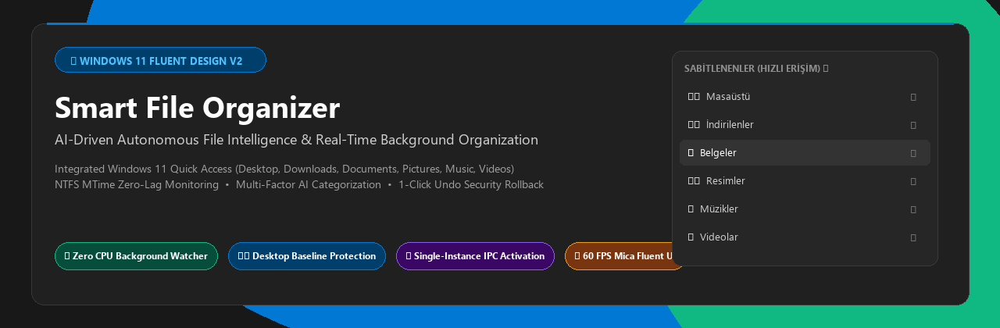
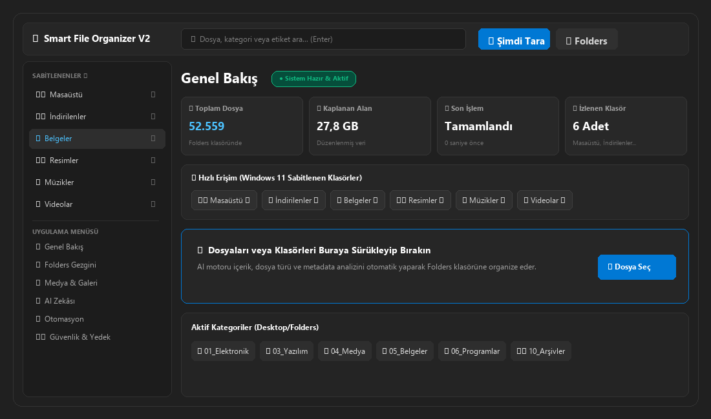
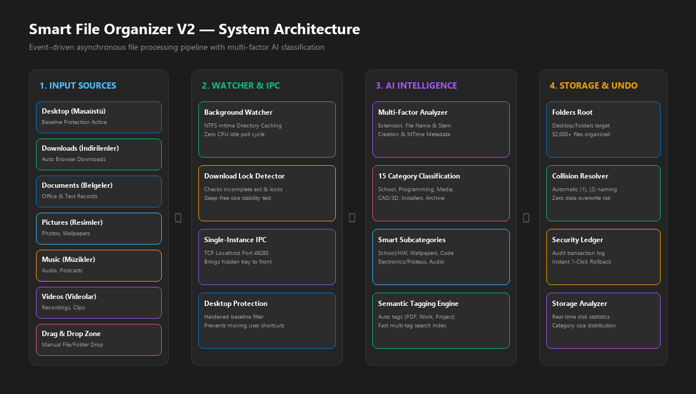

# 📂 Smart File Organizer V2
### Windows 11 Fluent Design + AI File Intelligence System

<p align="center">
  
</p>

<p align="center">
  
  
  
  
  
</p>

---

## 🌟 Genel Bakış (Overview)

**Smart File Organizer V2**, modern Microsoft Windows 11 Fluent Design prensiplerini ve çok boyutlu yapay zekâ dosya zekâsı sistemini bir araya getiren gelişmiş bir masaüstü dosya otomasyon platformudur.

Arka planda sessizce çalışırken **Masaüstü, İndirilenler, Belgeler, Resimler, Müzikler ve Videolar** gibi kritik giriş klasörlerini sıfır CPU maliyetiyle izler. Yeni indirilen veya oluşturulan dosyaları içeriklerine, dosya türlerine ve metadatalarına göre analiz ederek `C:\Users\<Kullanıcı>\Desktop\Folders` dizini altında akıllıca kategorilendirir.

<p align="center">
  
</p>

---

## ✨ Temel Özellikler (Key Features)

### 🎨 Windows 11 Fluent Design & 60 FPS Akıcı Deneyim
- **Mica & Acrylic Efektleri:** Windows 11 File Explorer ve Settings tarzında zarif koyu/açık tema paletleri (`#202020` Mica Dark).
- **Yırtılmasız Tuval (Solid Surface Blitting):** CustomTkinter üzerinde 60 FPS hızında hayaletsiz, pürüzsüz kaydırma (`yscrollincrement=4`).
- **Doğal İkonografi:** Windows yerel sistem kabuğundan (`IShellItemImageFactory`) alınan orijinal yüksek çözünürlüklü klasör ikonları.

### 📌 Windows 11 Sabitlenen Klasörler (Hızlı Erişim)
- Kenar çubuğunda ve ana ekranda **Masaüstü, İndirilenler, Belgeler, Resimler, Müzikler ve Videolar** klasörleri orijinal renkli kabuk ikonları ve sağa hizalı sabitleme pini (`📌`) ile yer alır.
- Tek tıkla ilgili klasörün içeriğini görüntüleme, tek tek veya toplu olarak `Folders` dizinine organize etme imkanı.

### 🛡️ Masaüstü Koruma Tabanı (Desktop Baseline Protection)
- Masaüstünüzde önceden mevcut olan tüm kısayollar, sistem dosyaları ve çalışma klasörleri otomatik olarak kilitlenir ve korunur.
- **Asla dokunulmaz:** Masaüstünüzdeki 20+ kısayol yerinde kalır; yalnızca masaüstüne yeni indirilen, taşınan veya oluşturulan dosyalar organize edilir.

### ⚡ Tekil Örnek & Kısayoldan Anında Uyandırma (Single-Instance IPC)
- Uygulama arka planda veya sistem tepsisinde (saat yanında) sessizce çalışırken masaüstündeki kısayola tekrar tıklandığında hata vermez.
- Yerel TCP IPC (`127.0.0.1:49285`) üzerinden çalışan arka plan penceresini anında algılar, sistem tepsisinden geri yükler ve ekranın en önüne getirir.

### 🧠 Çok Boyutlu AI Dosya Zekâsı (AI Intelligence Engine)
- Yalnızca uzantıya göre değil; dosya adı, kök kelimeler, oluşturma tarihi, metadata ve bağlam analizi ile dosyaları 15 ana kategori ve akıllı alt kategorilere ayırır:
  - `01_Elektronik`, `02_Oyunlar`, `03_Yazılım`, `04_Medya`, `05_Belgeler`, `06_Programlar`, `07_Kısayollar`, `08_3D`, `09_Yazı`, `10_Arşivler`, `11_Teknik` vb.
- **Çakışma Koruması:** Hedefte aynı isimde dosya varsa üzerine yazmaz; otomatik `(1)`, `(2)` adlandırma ile sıfır veri kaybı garantisi sunar.

### 🎬 Yüksek Performanslı Medya & Video Galerisi
- Görseller ve videolar için Windows Shell & PIL tabanlı asenkron tekil kuyruk thumbnail yükleyici (`AsyncThumbnailLoader`).
- Video oynatma süresi, çözünürlük rozetleri ve dinamik filtreleme (Tümü, Görseller, Videolar).

### 🛡️ 1-Tıkla Geri Alma & Güvenlik Defteri (Transaction Undo Ledger)
- Yapılan tüm taşıma ve düzenleme işlemleri geri alınabilir güvenlik günlüğüne kaydedilir.
- Yanlış taşınan herhangi bir dosya tek tıkla orijinal konumuna geri döndürülebilir.

---

## 🏗️ Sistem Mimarisi (Architecture)

<p align="center">
  
</p>

```
GİRİŞ KAYNAKLARI (Sources)
├── 🖥️ Masaüstü (Baseline Korumalı)
├── ⬇️ İndirilenler (Downloads)
├── 📄 Belgeler (Documents)
├── 🖼️ Resimler (Pictures)
├── 🎵 Müzikler (Music)
├── 🎬 Videolar (Videos)
└── 📥 Sürükle & Bırak Bölgesi
           │
           ▼
ARKA PLAN İZLEYİCİSİ (Background Watcher)
├── NTFS MTime Önbellekleme (Sıfır CPU tüketimi)
├── İndirme Bitiş & Kilit Testi (Lock Detector)
└── Tekil Örnek IPC Portu (127.0.0.1:49285)
           │
           ▼
AI FILE INTELLIGENCE ENGINE
├── Dosya Adı & Uzantı Eşleme
├── Metadata & Boyut Analizi
└── 15 Kategori & Alt Kategori Belirleme
           │
           ▼
HEDEF DEPOLAMA & GÜVENLİK
├── C:\Users\<User>\Desktop\Folders
├── Güvenlik Defteri (Transaction Logging)
└── 1-Tıkla Geri Alma (Instant Undo)
```

---

## 📂 Proje Dizin Yapısı (Directory Structure)

```
FolderOrganizerApp/
├── assets/                     # Banner, mimari şemaları ve görsel varlıklar
│   ├── banner.png
│   ├── architecture_diagram.png
│   ├── dashboard_overview.png
│   └── logo.png
├── views/                      # Windows 11 Fluent UI Sayfaları
│   ├── __init__.py
│   ├── home_view.py            # Genel Bakış & Dashboard
│   ├── my_files_view.py        # Folders Gezgini (Kategoriler)
│   ├── quick_folder_view.py    # Windows 11 Sabitlenen Klasörler
│   ├── media_view.py           # Medya & Video Galeri
│   ├── ai_intelligence_view.py # AI Dosya Zekâsı Analizörü
│   ├── search_view.py          # Akıllı Arama Motoru
│   ├── automation_view.py      # Otomasyon & İzleme Ayarları
│   ├── duplicate_view.py       # Kopya (Duplicate) Yöneticisi
│   ├── storage_view.py         # Depolama Analizi & Dağılım
│   ├── security_view.py        # Güvenlik & Geri Alma Defteri
│   ├── activity_view.py        # Aktivite & Olay Merkezi
│   └── settings_view.py        # Uygulama & Windows Ayarları
├── app.py                      # Ana Uygulama Kabuğu & Sidebar
├── organizer.py                # AI Dosya Taşıma & Çakışma Motoru
├── intelligence.py             # Yapay Zekâ Kategorilendirme Motoru
├── watcher.py                  # NTFS MTime Arka Plan İzleyicisi
├── tray.py                     # Windows Sistem Tepsisi Entegrasyonu
├── theme.py                    # Windows 11 Fluent Tema Belirteçleri
├── animation.py                # Akıcı 60 FPS Mikro Geçişler
├── storage_analyzer.py         # Disk Analizörü & Önbellek
├── search_engine.py            # Semantik & Tam Metin Arama
├── duplicate_manager.py        # SHA-256 Kopya Dosya Bulucu
├── security_backup.py          # İşlem Günlüğü & Geri Alma
├── thumbnail_engine.py         # Asenkron Shell Thumbnail Çıkarıcı
├── config.py                   # Ayar Yöneticisi & Koruma Tabanı
├── config.json                 # Kullanıcı Tercihleri
├── create_shortcut.py          # Masaüstü Kısayol Oluşturucu
├── baslat.vbs                  # Konsolsuz Sessiz Başlatıcı
├── requirements.txt            # Python Bağımlılıkları
└── README.md
```

---

## 🚀 Kurulum & Çalıştırma (Installation & Setup)

### 1. Gereksinimler
- Windows 10 veya Windows 11
- Python 3.10 veya üzeri

### 2. Bağımlılıkları Yükleyin
```bash
git clone https://github.com/Venarus/smart-file-organizer.git
cd smart-file-organizer
pip install -r requirements.txt
```

### 3. Uygulamayı Başlatın
- **Normal Başlatma:**
  ```bash
  python app.py
  ```
- **Konsolsuz Arka Plan Modunda Başlatma:**
  `baslat.vbs` dosyasına çift tıklayın veya:
  ```bash
  pythonw app.py
  ```

### 4. Masaüstü Kısayolu Oluşturma
Masaüstünüze Windows 11 ikonlu otomatik başlatıcı kısayol eklemek için:
```bash
python create_shortcut.py
```

---

## ⚙️ Yapılandırma (Configuration)

Ayarlar `config.json` dosyası üzerinden otomatik yönetilir:

```json
{
    "sources": [
        "C:\\Users\\senem\\Desktop",
        "C:\\Users\\senem\\Downloads",
        "C:\\Users\\senem\\Documents",
        "C:\\Users\\senem\\Pictures",
        "C:\\Users\\senem\\Music",
        "C:\\Users\\senem\\Videos"
    ],
    "target": "C:\\Users\\senem\\Desktop\\Folders",
    "auto_watch": true,
    "check_interval": 4,
    "allow_new_categories": true,
    "start_with_windows": true,
    "minimize_to_tray_on_close": true,
    "theme_mode": "dark"
}
```

---

## 👨‍💻 Geliştirici (Author)

- **Geliştirici:** [Venarus](https://github.com/Venarus)
- **Lisans:** [MIT](LICENSE)
