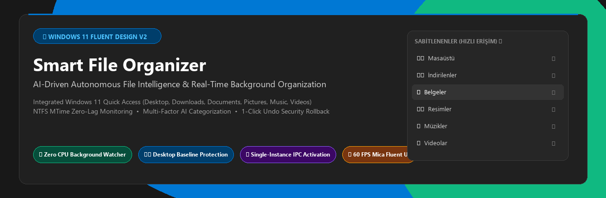
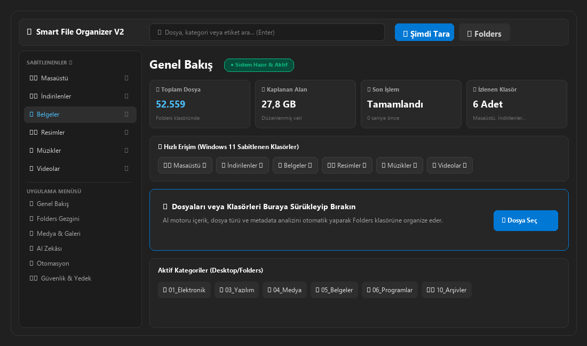

# 📂 Smart File Organizer v2.1.0
### Windows 11 Fluent Motion + AI File Intelligence System

<p align="center">
  
</p>

<p align="center">
  
  
  
  
  
</p>

---

## 🌟 Genel Bakış (Overview)

**Smart File Organizer v2.1.0**, modern Microsoft Windows 11 Fluent Design prensiplerini, merkezi bir 60 FPS hareket/animasyon motorunu (`FluidAnimator`) ve çok boyutlu yapay zekâ dosya zekâsı sistemini bir araya getiren masaüstü dosya otomasyon platformudur.

Arka planda sessizce çalışırken **Masaüstü, İndirilenler, Belgeler, Resimler, Müzikler ve Videolar** gibi kritik giriş klasörlerini sıfır CPU maliyetiyle izler. Yeni indirilen veya oluşturulan dosyaları içeriklerine, dosya türlerine ve metadatalarına göre analiz ederek `C:\Users\<Kullanıcı>\Desktop\Folders` dizini altında akıllıca kategorilendirir.

<p align="center">
  
</p>

---

## 🚀 v2.1.0 Yenilikleri (What's New in v2.1.0)

### 🎬 Merkezi Fluent Animasyon Motoru (`animation.py`)
- **Standart Zamanlama & Eğriler:** Mikro etkileşimler (`140–150ms`), sayfa ve modal geçişleri (`200ms`), karmaşık sayaç ve ilerleme çubuğu geçişleri (`300ms`) için matematiksel `Ease-Out`, `Ease-In` ve `Ease-In-Out` kübik eğrileri.
- **Sıfır Tıklama Kayması (Zero Hitbox Jitter):** Geometriyi kaydırmadan RGB renk interpolasyonu (`FluentTheme.interpolate_color`), yüzey aydınlatması ve tuval kaydırma ile %100 güvenilir buton tıklamaları.
- **Animasyon & Erişilebilirlik Modları:** `Tam Animasyonlar (Full)`, `Azaltılmış Animasyonlar (Reduced)` ve `Devre Dışı (Disabled)` seçenekleri + Windows `SPI_GETCLIENTAREAANIMATION` işletim sistemi erişilebilirlik algılaması.

### ⌘ Hızlı Komut Paleti (`Ctrl + K` — `command_palette.py`)
- Herhangi bir ekrandayken `Ctrl + K` kısayolu veya üst bardaki **⌘ Komutlar** butonu ile açılan Windows 11 Fluent modal komut paleti.
- Tüm uygulama sayfalarına, sabitlenen klasörlere ve gerçek sistem aksiyonlarına (*Şimdi Tara, Son İşlemi Geri Al, Tema Değiştir, Masaüstü Korumasını Yenile*) anında arama ve `↑` `↓` `Enter` `Esc` klavye navigasyonu.

### 🔔 Bildirim Merkezi & Sağ-Tık Bağlam Menüsü (`notification_center.py`)
- **Bildirim Merkezi (Notification Flyout):** Üst barda okunmamış bildirim sayacı (`🔔`) ve açılır bildirim geçmişi çekmecesi; mükemmel mükerrer bildirim engelleme (deduplication) ve seviye rozetleri (`success`, `info`, `warning`, `error`).
- **Fluent Sağ-Tık Menüsü (`FluentContextMenu`):** Dosya ve klasör satırlarına sağ tıklayarak *Aç*, *Klasörde Göster*, *AI Zekâsı ile İncele* ve *Yolu Panoya Kopyala* aksiyonlarına anında erişim.

### ⚡ Önbellekli Anlık Sayfa Geçişleri & Katlanabilir Kenar Çubuğu (`app.py`)
- **Görünüm Önbelleği (`_view_cache`):** Sayfalar arası geçişlerde bileşenleri yeniden oluşturmak yerine önbellekten anında geri yükleyerek sıfır titreşim (zero-flicker) ve `<5ms` sayfa geçiş süresi.
- **Katlanabilir Menü Bölümleri & Aktif Gösterge Çubuğu:** Sol menüdeki kategori başlıklarını (`▾` / `▸`) daraltıp genişletebilme ve aktif sayfanın sol kenarında Windows 11 mavi vurgu çubuğu (`nav_indicator`).
- **Python 3.15 Thread-Safe `UIBridge`:** Arka plan iş parçacıklarından ana UI iş parçacığına güvenli kuyruk (`queue.Queue`) iletimi ve iskelet (skeleton shimmer) yükleme ekranları.

---

## ✨ Temel Özellikler (Core Features)

- **📌 Windows 11 Sabitlenen Klasörler:** Masaüstü, İndirilenler, Belgeler, Resimler, Müzikler ve Videolar için gerçek Windows Shell ikonları (`IShellItemImageFactory`) ve büyük klasörler için sayfalandırma (`PAGE_SIZE = 80`).
- **🛡️ Masaüstü Koruma Tabanı (Desktop Baseline Protection):** Masaüstünüzde önceden var olan kısayol ve klasörler kilitlenir; yalnızca yeni gelen dosyalar organize edilir.
- **⚡ Tekil Örnek & Kısayoldan Uyandırma (Single-Instance IPC):** Arka planda çalışırken masaüstü kısayoluna tıklandığında mevcut pencereyi `127.0.0.1:49285` üzerinden anında ekranın en önüne getirir.
- **🧠 Çok Boyutlu AI Dosya Zekâsı:** Dosya adı, uzantı, içerik ve metadata analizi ile 15+ kategoriye akıllı sınıflandırma.
- **🛡️ 1-Tıkla Geri Alma (Undo Ledger):** Yapılan her dosya hareketini tek tıkla eski konumuna döndürme.

---

## ⌨️ Klavye Kısayolları (Keyboard Shortcuts)

| Kısayol | İşlev |
| :--- | :--- |
| `Ctrl + K` | Hızlı Komut Paletini (Command Palette) açar / kapatır |
| `Ctrl + F` | Üst bardaki genel arama kutusuna odaklanır |
| `F5` | Aktif sayfanın verilerini ve önbelleğini yeniler |
| `Esc` | Açık olan Komut Paleti, Bildirim Merkezi veya Bağlam Menüsünü kapatır |
| `Sağ Tık` | Dosya ve klasör satırlarında hızlı işlem menüsünü açar |

---

## 🚀 Kurulum & Çalıştırma (Installation & Setup)

### Seçenek 1: Taşınabilir Windows x64 EXE (Python Gerektirmez)
1. [Releases](https://github.com/Venarus/smart-file-organizer/releases) sayfasından `SmartFileOrganizer-v2.1.0-Windows-x64.zip` arşivini indirin ve çıkartın.
2. `SmartFileOrganizer.exe` dosyasına çift tıklayarak doğrudan çalıştırın.

### Seçenek 2: Python Kaynak Kodundan Çalıştırma
```bash
git clone https://github.com/Venarus/smart-file-organizer.git
cd smart-file-organizer
pip install -r requirements.txt
python main.py
```

---

## ⚙️ Yapılandırma (`config.json`)

```json
{
    "sources": [
        "C:\\Users\\<Kullanıcı>\\Desktop",
        "C:\\Users\\<Kullanıcı>\\Downloads",
        "C:\\Users\\<Kullanıcı>\\Documents",
        "C:\\Users\\<Kullanıcı>\\Pictures",
        "C:\\Users\\<Kullanıcı>\\Music",
        "C:\\Users\\<Kullanıcı>\\Videos"
    ],
    "target": "C:\\Users\\<Kullanıcı>\\Desktop\\Folders",
    "auto_watch": true,
    "check_interval": 4,
    "theme": "dark",
    "animation_mode": "full",
    "respect_system_motion": true,
    "notifications": true,
    "protect_existing_desktop": true
}
```

---

## 👨‍💻 Geliştirici (Author)

- **Geliştirici:** [Venarus](https://github.com/Venarus)
- **Lisans:** [MIT](LICENSE)
